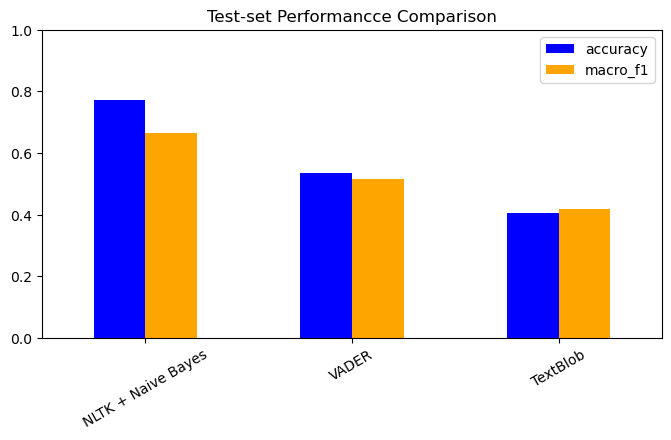
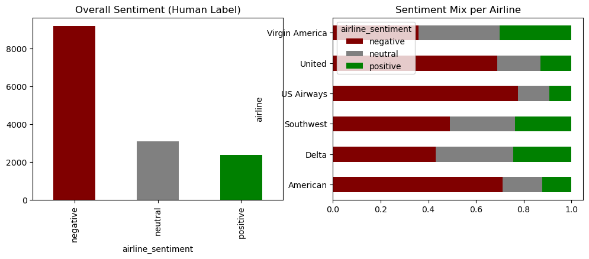
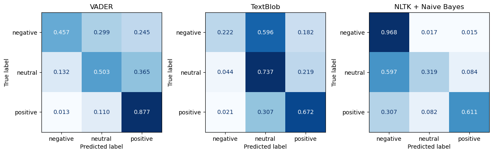

# When Does an LLM Earn Its Cost? Airline Tweet Sentiment from VADER to Claude

**Comparing three generations of sentiment analysis on 14,640 tweets to US airlines: rule-based lexicons, a classic machine-learning classifier, and a zero-shot large language model.**

`Python` · `NLTK` · `VADER` · `TextBlob` · `scikit-learn` · `Anthropic Claude API`

---

## The headline

| Approach | How it works | Training needed | Accuracy | Macro-F1 |
|---|---|---|---|---|
| TextBlob | General-purpose word lexicon | None | 0.40 | 0.42 |
| VADER | Social-media lexicon + rules | None | 0.53 | 0.52 |
| **NLTK Naive Bayes** | Bag-of-words + negation marking | 11,712 labelled tweets | **0.77** | **0.66** |
| **Claude Haiku (zero-shot)** | One prompt, no examples | None | **0.87** | **0.82** |

*Lexicons and Naive Bayes were scored on a fixed, stratified 2,928-tweet test set. Claude was scored on a 200-tweet random sample (see [limitations](#honest-limitations)).*

**What this shows:** A trained classic model easily beats untrained lexicons. A zero-shot LLM, with no training data at all, beats them all, and the gap is largest on the hardest class, *neutral*.



## The question

Every customer-support team that monitors social media faces the same trade-off: **is a free, instant rule-based tool good enough, or is it worth paying per message for an LLM?** This project measures that trade-off on real customer tweets.

## The data

[Twitter US Airline Sentiment](https://www.kaggle.com/datasets/crowdflower/twitter-airline-sentiment): 14,640 tweets labelled *negative*, *neutral* or *positive* by human annotators. The data is **heavily imbalanced** (63% negative), which is why I chose **macro-F1** as the main metric. Accuracy alone rewards a model that just guesses "negative."



## Approach and modelling decisions

### Shared setup
- **Fixed, stratified 80/20 split** (`random_state=42`) created once and reused, so every classic model is scored on exactly the same tweets with the same class balance.
- **Light, targeted cleaning.** URLs and `@mentions` were removed. Every tweet starts with an airline handle, so mentions add noise rather than sentiment. Hashtag symbols were stripped but the words kept, and HTML entities decoded.
- **One evaluation function** reports accuracy, macro-F1 and a full per-class report for every model, keeping comparisons consistent.

### Tier 1: Lexicon baselines (VADER, TextBlob)
- No training. Each word has a pre-assigned sentiment score.
- I first probed both tools on hand-written edge cases ("GOOD!!!", "not good", "good but the food was terrible", emoticons) to see how they behave before trusting them. VADER handles capitals, punctuation and emoticons; TextBlob doesn't.
- Their continuous scores were mapped to three classes with a **±0.2 neutral band**, so weakly-scored tweets fall into *neutral* instead of being forced into a polarity.
- **Finding:** Both have very high precision on *negative* (>0.90) but miss most negative tweets. Customer complaints are often factual ("flight delayed 3 hrs, no updates") and contain few "negative words," so lexicons can't see them.

### Tier 2: NLTK + Naive Bayes
- **`TweetTokenizer`** with lowercasing, handle stripping, and repeated-letter reduction ("soooo" → "sooo").
- **Negation marking (`mark_negation`).** Words after "not"/"no" get a `_NEG` suffix, so *"not like"* becomes `like_NEG`, a different feature from `like`. This is the main fix for bag-of-words' blindness to word order.
- **Custom stop-word list.** Standard NLTK stop words *minus* negations and intensifiers (`no`, `not`, `very`, `too`, `n't` forms). Default stop-word lists would delete exactly the words that flip sentiment.
- **Vocabulary capped at the 3,000 most frequent training tokens.** This limits overfitting to rare words and is built from the training set only.
- The most informative features make sense: *kudos, fantastic, <3* → positive; *hrs, hold* → negative (long delays and long phone holds).

### Tier 3: Claude Haiku, zero-shot
- A short, explicit prompt: classify the tweet and **reply with exactly one word**. It includes one instruction on **sarcasm** (*"thanks for losing my bag" is negative*), the classic failure case for lexicons.
- **Defensive output parsing.** The reply is lowercased, stripped of punctuation, and checked against the three valid labels, falling back to *neutral* if anything unexpected comes back. One malformed reply can't break the pipeline.
- `max_tokens=20` and thinking disabled keep each call cheap and fast.
- **The API key is read from a `.env` file** via `python-dotenv` and never appears in code. `.env` is git-ignored.

## Results in detail



- **Neutral is the hardest class for everyone.** Naive Bayes catches only 32% of neutral tweets. It learned that most tweets are negative and leans that way.
- **Claude's mistakes are mostly between neighbouring classes** (neutral ↔ negative). On the 200-tweet sample it confused positive with negative only 4 times. On the *same* 200 tweets, VADER labelled 37 negative tweets as positive.
- [`outputs/error_analysis_predictions.csv`](outputs/error_analysis_predictions.csv) has every test tweet with all three classic models' predictions side by side, for manual error review.

## So, when does an LLM earn its cost?

- **High-volume, low-stakes monitoring** (dashboards, trend lines): **Naive Bayes.** It's essentially free, trains in seconds, and gets 77% accuracy.
- **Routing or escalation, where nuance matters** (sarcasm, neutral enquiries vs real complaints): **an LLM.** The extra 10+ points of accuracy and much better neutral detection are worth a per-call cost.
- **Lexicons alone** aren't reliable enough for this domain, except as a zero-setup sanity check.

## Honest limitations

I want to be upfront about what this comparison does *not* yet show:
- **Claude was evaluated on a different sample.** It was a random 200 tweets from the full dataset, not the fixed test split, and some of those tweets were in Naive Bayes' training data. The direction of the result is clear, but a strict head-to-head should score all models on the same stratified test subset.
- **Speed and cost per 1,000 predictions** weren't logged yet. Timing each tier and recording token usage would turn "LLMs cost more" into an actual number.
- The two VADER runs use different neutral thresholds (±0.2 vs ±0.05). Standardising them would tidy the comparison.

**Next steps:** score every model on one shared 300-tweet test subset, log latency and cost per 1,000 predictions, add a TF-IDF + Logistic Regression baseline, and build a 30-tweet "hard cases" set (sarcasm, mixed sentiment) to stress-test each tier.

## Run it yourself

```bash
pip install -r requirements.txt
python -m nltk.downloader stopwords vader_lexicon

# For the Claude notebook only:
cp .env.example .env        # then paste your Anthropic API key into .env

jupyter notebook
```
- `01_classic_nlp.ipynb`: EDA, VADER, TextBlob, Naive Bayes, comparison, error analysis
- `02_claude_llm_sentiment.ipynb`: zero-shot Claude classification vs VADER

## Repository layout
```
01_classic_nlp.ipynb
02_claude_llm_sentiment.ipynb
Tweets.csv                 # Twitter US Airline Sentiment dataset
outputs/                   # per-tweet predictions for error analysis
images/                    # charts used in this README
.env.example               # template for your API key (real .env is git-ignored)
```

---
*Analysis by Patrick Jastia.*
